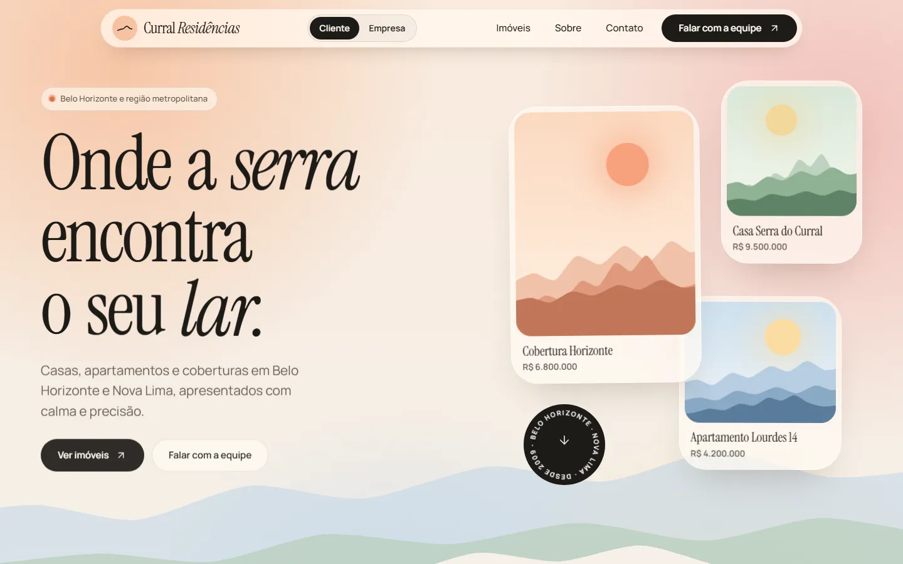

<div align="center">

# Curral Residências

**A modern-luxury real estate site for Belo Horizonte.**
One view for buyers, one for the agency.

[](https://real-estate-puce-iota.vercel.app/)




</div>

> **Portfolio project.** The agency, its people, listings, prices and numbers are all fictional. Neighborhood names are real places used only as setting. Frontend only: static typed data and demo forms, no backend.

## Highlights

- **Cinematic home page** built around the Serra do Curral skyline, with GSAP motion and smooth scrolling.
- **Listings explorer** with filters, and a detail page for each sample property.
- **Agency dashboard** (`/painel`) to manage listings and the team, review changes and see history.
- **Generated social previews** (Open Graph images) for the site and each listing.
- **About, contact, privacy and terms** pages, plus a custom 404.
- **Accessible motion:** every animation has a visible end state without JavaScript, and reduced motion is respected.
- **Typed and tested:** TypeScript, Zod validation and Vitest.

## Tech stack

| Area | Choice |
|---|---|
| Framework | Next.js 16 (App Router), React 19 |
| Language | TypeScript, Zod |
| Motion | GSAP (`@gsap/react`), Motion, Lenis |
| Icons | lucide-react |
| Fonts | Manrope + Instrument Serif (`next/font`) |
| Tests | Vitest |

## Getting started

```bash
npm install
npm run dev        # http://localhost:3000
```

## Scripts

| Command | What it does |
|---|---|
| `npm run dev` | Dev server |
| `npm run lint` | ESLint |
| `npm run typecheck` | Generates route types, then `tsc --noEmit` |
| `npm test` | Vitest suite |
| `npm run build` | Static export to `out/` |
| `npm run check` | Lint, typecheck, tests and build in order |

## Structure

```
src/
  app/            Routes (App Router), global CSS, layout
  components/
    layout/       Page-transition shell, TransitionLink
    providers/    Client providers (Lenis, composition)
    ui/           Shared presentational components
  data/           Typed static data: listings, team, neighborhoods, site facts
  lib/
    fonts.ts      next/font setup (Manrope, Instrument Serif)
    motion/       GSAP registration, motion config, useMotion, scroll helpers, reduced-motion state
  styles/
    base.css      Tokens (palette, radii, easings), reset, type scale, buttons, reveal primitives
    layout.css    Header, menu sheet, footer, page curtain
    home.css      Home sections and all ambient motion keyframes
```

## Motion conventions

- Create animation with `useMotion` (`src/lib/motion/use-motion.ts`): it wraps `gsap.matchMedia()` and `useGSAP`, hands you `mode` (`full`, `light` or `reduced`) and reverts everything on breakpoint change, on the animation switch and on unmount.
- Animate `transform` and `opacity` only. Durations and easings come from `src/lib/motion/config.ts` (GSAP) or the `--ease` tokens in base.css (CSS).
- Every animated element must have a visible end state without JavaScript. Reduced motion is the site switch (`data-motion="reduced"` on `<html>`, persisted in `localStorage`) or the OS setting.
- `SplitText` and `Flip` load on demand through `loadSplitText()` and `loadFlip()`.
